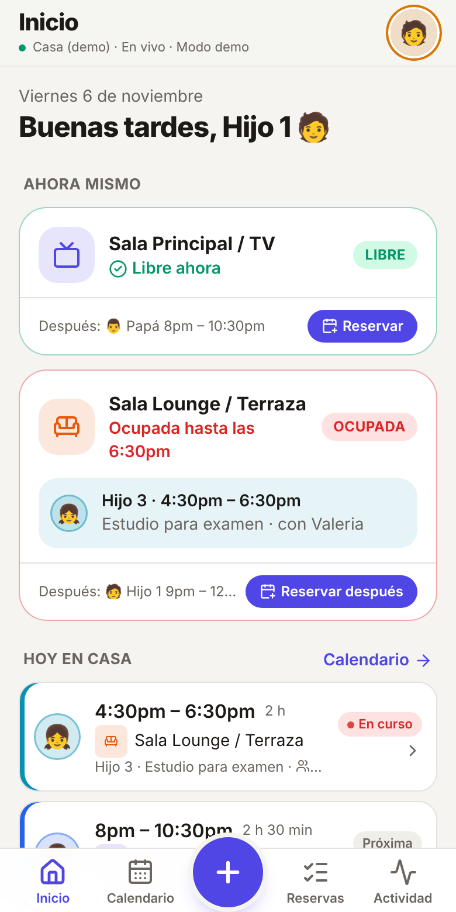
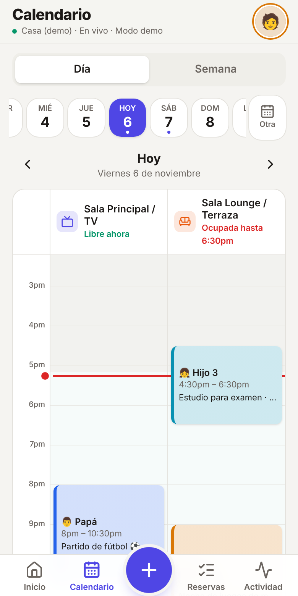
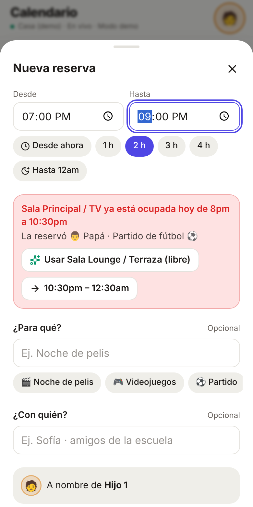
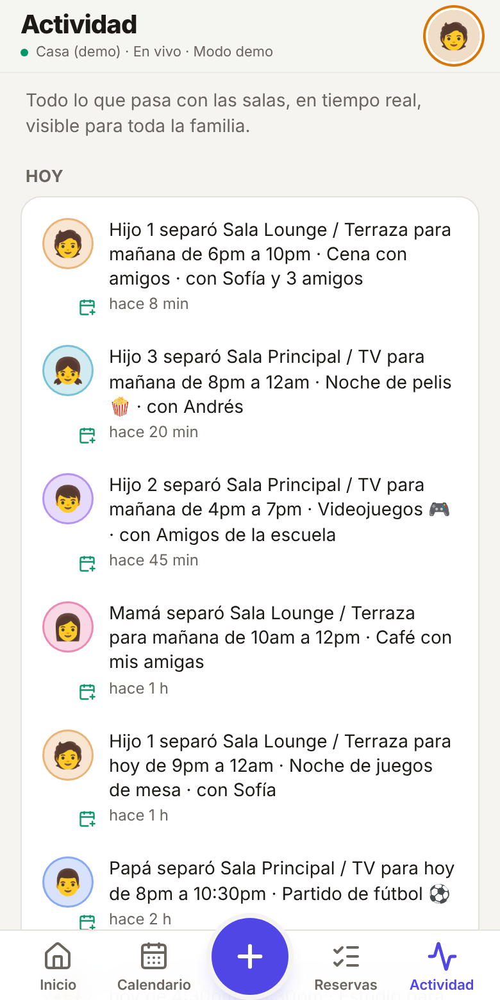

# 🛋️ Salas de la Casa

PWA para que la familia **reserve las salas de la casa sin traslapes ni confusiones**. Muestra en tiempo real qué sala está libre u ocupada, quién la reservó, para cuándo y con quién. Se instala como app en iPhone y Android, y **cuesta $0** (Supabase Free + Vercel Hobby).

<p align="center">
  
  
  
  
</p>

## ✨ Qué hace

| Requisito | Cómo quedó |
|---|---|
| **Selector rápido de perfil** | Pantalla “¿Quién eres?” con los 5 perfiles (Papá, Mamá, Hijo 1–3) + **PIN de 4 dígitos**. El celular recuerda tu perfil; no hay contraseñas que olvidar. |
| **2 salas editables** | “Sala Principal / TV” y “Sala Lounge / Terraza” ya creadas. Papá/Mamá pueden renombrarlas, cambiar ícono/color o agregar más. |
| **Disponibilidad en tiempo real** | Tarjetas **Libre (verde) / Ocupada (rojo)** “ahora mismo”, **timeline del día** por sala (bloques con el color de quien reservó) y **vista de 7 días**. Todo se actualiza solo en todos los celulares (Supabase Realtime). |
| **Sin empalmes** | El formulario avisa del choque antes de enviar y sugiere *“Usar la otra sala (libre)”* o *“siguiente horario libre”*. Además, **Postgres lo hace imposible** con una restricción `EXCLUDE` (ni dos personas reservando al mismo milisegundo pueden encimarse). |
| **Formulario de reserva** | Sala, día (hoy o cualquier fecha futura), hora inicio/fin (cruza medianoche: 10pm–1am), atajos de 1–4 h, *“Para qué”* y *“Con quién”* (ej. *Noche de pelis · con Sofía*). Se reserva a nombre del perfil activo. |
| **Historial y cancelación** | Pestañas *Próximas / Mías / Historial*. Solo **quien creó la reserva o un admin** (Papá/Mamá) puede editarla o cancelarla. Si ya empezó: **“Liberar sala ahora”**. |
| **Feed de actividad** | *“Hijo 1 separó Sala Lounge para este sábado de 8pm a 12am · Noche de pelis · con Sofía”*. Avisos emergentes cuando otra persona reserva y globito de “nuevo”. |
| **Webhook Telegram / WhatsApp** | Opcional, desde Ajustes: bot de **Telegram** (gratis, a un grupo) y/o **webhook** JSON (n8n, Make, Zapier, Discord, Slack…). Se envía desde la base de datos, sin servidor extra. |
| **PWA** | Ícono en pantalla de inicio, pantalla completa, modo oscuro automático, funciona con mala señal (la app abre sin internet), aviso de “nueva versión”. |

> **¿Solo quieres verla?** Sin configurar nada arranca en **modo demo** (datos de ejemplo guardados en tu navegador, PIN `1234`):
> ```bash
> npm install
> npm run dev        # http://localhost:5173
> ```

---

## 🚀 Ponerla en marcha en ~5 minutos

Necesitas: una cuenta de **GitHub**, una de **[Supabase](https://supabase.com)** y una de **[Vercel](https://vercel.com)** (las tres gratis, puedes entrar con GitHub).

### 1) Crea la base de datos (Supabase) — 2 min

1. En [supabase.com/dashboard](https://supabase.com/dashboard) → **New project**. Ponle nombre (ej. `salas-casa`), una contraseña cualquiera para la base de datos y la región más cercana (ej. *East US* si estás en México). Espera ~1 min a que se cree.
2. Abre **SQL Editor** → **New query**.
3. Copia **todo** el archivo [`supabase/schema.sql`](supabase/schema.sql) y pégalo.
4. **Antes de correrlo**, edita la sección `CONFIGURACIÓN INICIAL` (hasta arriba):
   ```sql
   'mi-casa-2026'        as family_code,  -- código de la casa (se pide 1 vez por celular)
   '0000'                as initial_pin,  -- PIN inicial de todos (al entrar se pide cambiarlo)
   'Mi casa'             as house_name,
   'America/Mexico_City' as timezone;
   ```
   Usa un código de la casa fácil de decir pero difícil de adivinar, ej. `tacos-al-pastor-27`. Si quieres, cambia ahí mismo los nombres de los perfiles y las salas (sección 9).
5. Presiona **Run**. Debe terminar en *Success*.
6. Ve a **Authentication → Sign In / Providers** (en algunos paneles: *Authentication → Settings*) y activa **“Allow anonymous sign-ins”** → **Save**.
   > Es lo que permite entrar solo con el código de la casa, sin correos ni contraseñas.
7. Copia tus llaves: botón **Connect** (arriba) o **Project Settings → API Keys**:
   - **Project URL** → `https://xxxx.supabase.co`
   - **Publishable key** (`sb_publishable_…`; en proyectos antiguos se llama **anon public**).

   La publishable/anon key **sí puede ir en el navegador**: sin el código de la casa no deja leer nada (RLS). **Nunca** uses la *secret / service_role key* en la app.

### 2) Publica la app (Vercel) — 2 min

**Opción A – botón** (si tu repo es público):

[](https://vercel.com/new/clone?repository-url=https%3A%2F%2Fgithub.com%2FOscarM97%2FApp-Salas&env=VITE_SUPABASE_URL,VITE_SUPABASE_ANON_KEY&envDescription=URL%20y%20Publishable%20(anon)%20key%20de%20tu%20proyecto%20de%20Supabase&project-name=salas-de-la-casa&repository-name=salas-de-la-casa)

**Opción B – importar tu repo** (funciona también si es privado):

1. [vercel.com/new](https://vercel.com/new) → **Import** el repositorio `App-Salas`.
2. Vercel detecta **Vite** solo (build `npm run build`, salida `dist`). No cambies nada.
3. En **Environment Variables** agrega:

   | Nombre | Valor |
   |---|---|
   | `VITE_SUPABASE_URL` | tu Project URL |
   | `VITE_SUPABASE_ANON_KEY` | tu Publishable (anon) key |

4. **Deploy**. En ~1 min tendrás una URL tipo `https://salas-de-la-casa.vercel.app`.

> Si cambias las variables después, haz **Redeploy** (Vite las incrusta al compilar).
> ¿Prefieres **Netlify**? *Add new site → Import from Git*: el archivo `netlify.toml` ya trae todo; solo agrega las mismas 2 variables.

### 3) Instálala en cada celular — 1 min por persona

Manda la URL al grupo de la familia y que cada quien:

- **iPhone (Safari):** abre la URL → botón **Compartir** ⬆️ → **Agregar a inicio**.
- **Android (Chrome):** abre la URL → aparece **“Instalar app”** (o menú ⋮ → *Instalar app / Agregar a pantalla principal*).

Primer uso en cada celular:

1. Escribe el **código de la casa** (solo esta vez).
2. Toca tu perfil y escribe el **PIN inicial** (`0000` o el que pusiste).
3. Crea tu **PIN personal** de 4 dígitos. ¡Listo!

Luego Papá/Mamá pueden ir a **Ajustes** (tocando su avatar) para poner los nombres reales de los hijos, emojis, colores, nombres de las salas y la zona horaria.

### 4) (Opcional) Avisos en Telegram / WhatsApp — 3 min

Los avisos se mandan **desde Supabase** con la extensión `pg_net` (el script intenta activarla; si en Ajustes ves un aviso, actívala en **Database → Extensions → pg_net**).

**Telegram (recomendado, gratis, a un grupo):**

1. En Telegram abre **@BotFather** → `/newbot` → copia el **token** (`123456789:AA…`).
2. Agrega el bot al grupo de la familia y escribe cualquier mensaje en el grupo.
3. Abre `https://api.telegram.org/bot<TOKEN>/getUpdates` y copia el `"chat":{"id": -100…}`.
4. En la app: **Ajustes → Avisos** → pega token y chat ID → activa → **Guardar** → **Probar**.

Llegarán mensajes como: `✅ Hijo 1 acaba de separar Sala Lounge / Terraza para este sábado de 8pm a 12am · Noche de pelis · con Sofía`.

**WhatsApp / otros:** WhatsApp no tiene API gratuita para grupos. Usa el campo **Webhook**: la app hace `POST` con este JSON a la URL que pongas, y desde ahí lo reenvías con n8n, Make, Zapier, Pipedream, etc. (a WhatsApp Business, a CallMeBot para un número personal, a Discord, Slack…):

```json
{
  "text": "✅ Hijo 1 acaba de separar Sala Lounge / Terraza para este sábado de 8pm a 12am",
  "content": "(igual que text, para Discord)",
  "event": "reservation.created",
  "data": { "owner_name": "Hijo 1", "room_name": "Sala Lounge / Terraza", "starts_at": "…", "ends_at": "…", "purpose": "…", "guests": "…" },
  "created_at": "2026-11-06T23:10:00Z"
}
```

Eventos: `reservation.created`, `reservation.updated`, `reservation.cancelled`, `reservation.released`, `room.created`, `room.updated`.

### 5) (Recomendado) Que Supabase no se “duerma”

El plan gratis de Supabase **pausa proyectos sin uso por ~7 días** (por ejemplo, si se van de vacaciones). Para evitarlo, este repo trae el workflow [`keep-alive.yml`](.github/workflows/keep-alive.yml), que hace un *ping* cada 3 días:

GitHub → tu repo → **Settings → Secrets and variables → Actions → New repository secret**, y agrega `SUPABASE_URL` y `SUPABASE_ANON_KEY` (los mismos valores de Vercel). Puedes probarlo en **Actions → Mantener Supabase activo → Run workflow**.

> Si se llega a pausar: Supabase → tu proyecto → **Restore**. No se pierde nada.

---

### ¿La instalas para otra familia? Pruébala y luego déjala como nueva

1. Entra con el código de la casa y usa cualquier perfil (por ejemplo Papá, PIN `0000`, y crea un PIN temporal). Prueba en dos dispositivos a la vez para ver el tiempo real.
2. Cuando termines, corre [`supabase/reset.sql`](supabase/reset.sql) en el SQL Editor: borra reservas y actividad de prueba, saca a **todos** los dispositivos (incluido el tuyo) y regresa los PINs a `0000`.
3. Pásale a la familia la dirección y el código. Si no quieren que tú lo sepas, Papá o Mamá lo cambian en Ajustes → Seguridad.

> Quien es dueño del proyecto de Supabase puede ver los datos desde su panel. Si la familia quiere ser la única dueña, Supabase y Vercel permiten **transferir el proyecto** a la cuenta de alguien de la familia.

---

## 🔐 Cómo funciona la seguridad

```
Celular ──(1 vez) código de la casa──▶ sesión anónima de Supabase Auth (queda guardada)
        ──(cada que cambias de perfil) perfil + PIN──▶ RPC sign_in()  ──▶ Postgres
                                                                      │
   Leer: RLS → solo dispositivos que dieron el código ◀───────────────┤
   Escribir: SOLO funciones (RPC) que validan perfil, permisos y traslapes
   Garantía final: EXCLUDE USING gist (sala =, horario &&) en la tabla
```

- **Nadie escribe directo en las tablas.** No hay políticas de `INSERT/UPDATE/DELETE`: todo pasa por funciones `SECURITY DEFINER` (`create_reservation`, `cancel_reservation`, …) que revisan quién eres y qué puedes hacer.
- **Lecturas protegidas por RLS**: un visitante con la URL pero sin el código de la casa no ve nada.
- **PINs con bcrypt** en un esquema `private` que la API no expone. 5 intentos fallidos → perfil bloqueado 5 min. El código de la casa también limita intentos.
- **Permisos**: cada quien edita/cancela solo sus reservas; los perfiles **admin** (Papá/Mamá) pueden con todas, además de salas, familia, avisos, código de la casa y *“cerrar sesión en los demás dispositivos”* (por si se pierde un celular).
- Es seguridad pensada para una familia: el PIN evita que un hermano cancele la reserva de otro “por accidente”, y el código de la casa mantiene fuera a extraños.

## 🧠 Cómo se evitan los traslapes

1. **En el formulario**, en vivo: cada sala dice *“Libre en ese horario”* u *“Ocupada · Mamá”*, el botón se bloquea si hay choque y se ofrecen alternativas.
2. **En el servidor**, `create_reservation` / `update_reservation` verifican el choque y devuelven un mensaje claro: *“Sala TV ya está ocupada por Mamá hoy de 8pm a 10pm.”*
3. **En la base de datos**, la restricción

   ```sql
   exclude using gist (room_id with =, tstzrange(starts_at, ends_at, '[)') with &&)
   where (cancelled_at is null)
   ```

   hace imposible guardar dos reservas activas encimadas en la misma sala, aunque lleguen exactamente al mismo tiempo. El fin es exclusivo, así que 6–8pm y 8–10pm **sí** pueden convivir.

---

## 🗂️ Estructura del proyecto

```
├── supabase/
│   ├── schema.sql              # ⭐ Script único de BD: tablas, RLS, RPC, Realtime, avisos, datos iniciales
│   └── tests/                  # Pruebas del SQL contra Postgres real (npm run test:db)
├── src/
│   ├── App.tsx                 # Flujo: código → perfil+PIN → crear PIN → app (tabs + hojas)
│   ├── lib/
│   │   ├── backend/            # Interfaz Backend + SupabaseBackend + DemoBackend (localStorage)
│   │   ├── reservations.ts     # Traslapes, estado de salas, siguiente hueco libre, permisos
│   │   ├── activity.ts         # Textos del feed ("Hijo 1 separó…")
│   │   └── time.ts             # Formato "8pm", "este sábado", rangos que cruzan medianoche
│   ├── hooks/                  # React Query, tiempo real, instalación PWA, router por hash
│   ├── components/             # Timeline del día, vista semanal, formulario, tarjetas, PIN pad…
│   └── screens/                # Inicio, Calendario, Reservas, Actividad, Ajustes, Acceso
├── public/icons/               # Íconos PWA (SVG + PNG generados con `npm run icons`)
├── vercel.json / netlify.toml  # Despliegue y cabeceras
└── .github/workflows/          # CI (tests + build + SQL) y keep-alive de Supabase
```

**Stack:** Vite 8 + React 19 + TypeScript · Tailwind CSS 4 · lucide-react · TanStack Query · date-fns · Supabase (Postgres, Auth anónima, Realtime, pg_net) · vite-plugin-pwa (Workbox).

## 🧪 Desarrollo y pruebas

```bash
npm install
cp .env.example .env.local   # pon tus llaves (o déjalas vacías para modo demo)
npm run dev                  # http://localhost:5173
npm test                     # pruebas unitarias (Vitest): tiempos, traslapes, feed, reglas del backend
npm run test:db              # prueba schema.sql en un Postgres local (necesita PostgreSQL 14+)
npm run build                # typecheck + build de producción en dist/
```

`npm run test:db` levanta un Postgres desechable, simula lo mínimo de Supabase (roles, `auth.uid()`, Realtime) y corre más de 80 verificaciones: RLS, intrusos, PINs y bloqueo, traslapes (incluida la restricción `EXCLUDE`), permisos de admin, textos de los avisos, un `pg_net` simulado para Telegram/Webhook e idempotencia del script.

Para forzar el modo demo aunque tengas llaves: `VITE_DEMO=true npm run dev`.

## 🔧 Personalizar y actualizar

- **Nombres, emojis, colores, roles, salas, zona horaria, código de la casa:** desde la app (Ajustes, como admin).
- **Agregar personas** (abuela, novia que ya es de casa 😄): Ajustes → Familia → Agregar (con PIN inicial).
- **Íconos de la app:** edita `public/icons/icon.svg` y `maskable.svg` y corre `npm run icons`.
- **Actualizar la base de datos** cuando bajes una versión nueva: vuelve a correr `supabase/schema.sql` en el SQL Editor. Es **idempotente**: no borra reservas, perfiles ni PINs.

## 💸 Límites del plan gratuito (de sobra para una familia)

- **Supabase Free:** 500 MB de base de datos (≈ millones de reservas), 50 000 usuarios activos al mes, Realtime incluido. Se pausa tras ~7 días sin uso → ver paso 5.
- **Vercel Hobby:** gratis para proyectos personales no comerciales; HTTPS y dominio `*.vercel.app` incluidos.
- **Telegram Bot API:** gratis.

## 🆘 Solución de problemas

| Síntoma | Solución |
|---|---|
| Arriba dice **“Modo demo”** en Vercel | Faltan `VITE_SUPABASE_URL` / `VITE_SUPABASE_ANON_KEY` o no hiciste *Redeploy* después de agregarlas. |
| *“Falta activar Allow anonymous sign-ins”* | Supabase → Authentication → Sign In / Providers → actívalo. |
| *“Ese no es el código”* | Revisa el `family_code` que pusiste en el SQL (no distingue mayúsculas). Un admin puede cambiarlo en Ajustes → Seguridad. |
| Alguien olvidó su PIN | Un admin: Ajustes → Familia → la persona → *Restablecer* con un PIN temporal. |
| Se bloqueó un perfil | Espera 5 minutos o que un admin restablezca el PIN. |
| No llegan los avisos de Telegram | Activa `pg_net` (Database → Extensions), revisa token y chat ID (los grupos empiezan con `-100`), que el bot esté en el grupo y usa **Probar**. Los envíos quedan en la tabla `net._http_response`. |
| No veo cambios en vivo | El punto junto al nombre de la casa debe decir **En vivo**. Si dice *Conectando…*, revisa la conexión; al volver, la app se actualiza sola. |
| Se perdió un celular | Admin: Ajustes → Seguridad → cambia el código y **Cerrar sesión en los demás dispositivos**. |

## 🗺️ Ideas para después

- Notificaciones push del sistema (Web Push con una Edge Function de Supabase).
- Reservas recurrentes (“todos los viernes de 8 a 11pm”).
- Caché offline de las reservas para consultarlas sin internet.
